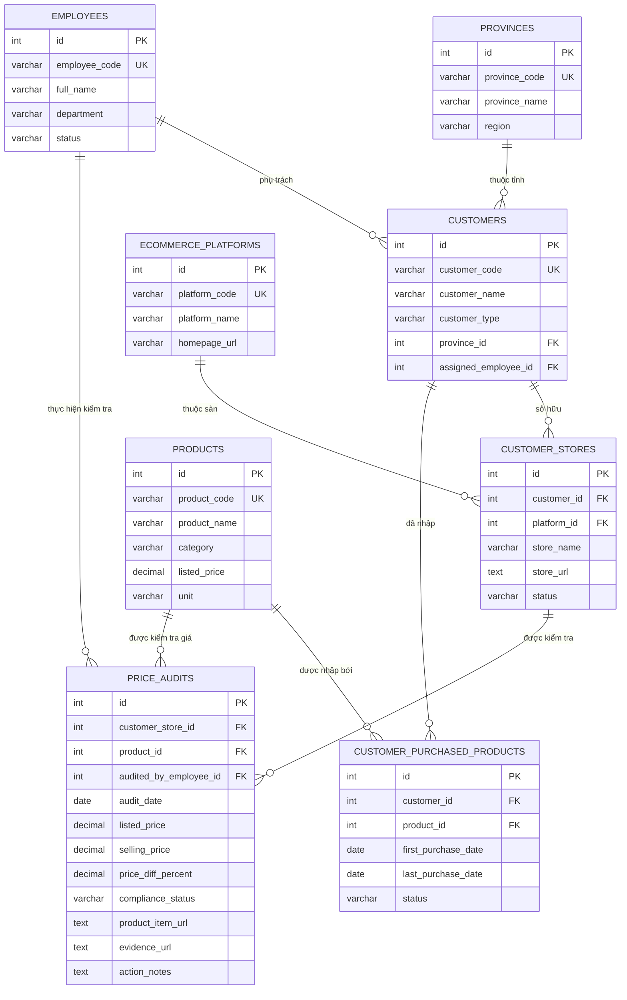

# HỆ THỐNG CƠ SỞ DỮ LIỆU QUẢN LÝ KHÁCH HÀNG & GIÁ BÁN SÀN TMĐT (KINGBLUE)

Hệ thống được bóc tách và chuẩn hóa theo chuẩn dữ liệu quan hệ **3NF (Third Normal Form) & BCNF** từ Google Sheet gốc:  
🔗 [Google Sheet Giám Sát Giá TMĐT](https://docs.google.com/spreadsheets/d/1dN2SIReDdk3EruHTTYUbsAH9X4UgIXmV5uUrOidrlbY/edit?gid=0#gid=0)

---

## 1. Phân Tích Nhược Điểm Bảng Sheet Hiện Tại (0NF - Unnormalized)

| Vấn đề | Hiện trạng trên Google Sheet | Giải pháp chuẩn hóa SQL (3NF) |
| :--- | :--- | :--- |
| **Vi phạm 1NF (Tính nguyên tử)** | Cột `Mã Sản phẩm KingBlue...` nhồi nhét **80 - 280 sản phẩm** trong 1 ô duy nhất phân tách bằng `\n`. | Tách thành bảng quan hệ nhiều-nhiều `customer_purchased_products` với mỗi dòng là 1 bản ghi duy nhất. |
| **Vi phạm 1NF (Đa trị)** | Cột `Link gian hàng` gộp chung 4 sàn (`SHOPEE:\nTIKTOK:\nLAZADA:\nWEBSITE...`). | Tách thành bảng thực thể `customer_stores` liên kết với bảng `ecommerce_platforms`. |
| **Vi phạm 2NF (Phụ thuộc một phần)** | Cột `Giá niêm yết KingBlue` đặt ngang hàng với khách hàng. Thực tế, giá niêm yết gắn liền với `Sản phẩm` chứ không thuộc về `Khách hàng`. | Đưa `listed_price` vào bảng `products` làm giá tham chiếu chuẩn. |
| **Vi phạm 3NF (Phụ thuộc bắc cầu)** | Các cột `Chênh lệch (%)`, `Tình trạng tuân thủ` là kết quả suy diễn từ `Giá bán` và `Giá niêm yết`. | Lưu kết quả tại thời điểm kiểm tra trong bảng sự kiện `price_audits` kèm `CHECK` constraint hoặc Computed Columns. |
| **Không thể truy vấn (Unqueryable)** | Không thể lọc theo sản phẩm cụ thể, không đếm được số đại lý đang bán sản phẩm A, không thống kê được lịch sử giá theo thời gian. | Hỗ trợ lập tức 100% các câu lệnh `JOIN`, `GROUP BY`, `WHERE`, `INDEX` tối ưu tốc độ. |

---

## 2. Mô Hình Thực Thể Quan Hệ (ERD - Entity Relationship Diagram)

---

## 3. Danh Mục Các Bảng Dữ Liệu (Data Dictionary)

### 3.1. Bảng `provinces` (Tỉnh/Thành)
- `id`: Khóa chính.
- `province_code`: Mã tỉnh (HCM, HN, DNG,...).
- `province_name`: Tên tỉnh/thành.
- `region`: Khu vực (Miền Nam, Miền Bắc, Miền Trung).

### 3.2. Bảng `employees` (Nhân sự phụ trách)
- `id`: Khóa chính.
- `employee_code`: Mã nhân viên (NV001, NV002,...).
- `full_name`: Tên nhân viên (BẢO TRÂM, XUÂN TRANG,...).
- `department`: Phòng ban phụ trách.

### 3.3. Bảng `customers` (Khách hàng / Đại lý / NPP)
- `id`: Khóa chính.
- `customer_code`: Mã đại lý (DL0001, DL0002,...).
- `customer_name`: Tên pháp nhân / Tên cửa hàng đại lý.
- `province_id`: FK liên kết với `provinces`.
- `assigned_employee_id`: FK liên kết với `employees`.

### 3.4. Bảng `ecommerce_platforms` (Sàn TMĐT)
- `id`: Khóa chính.
- `platform_code`: SHOPEE, TIKTOK, LAZADA, WEBSITE.
- `platform_name`: Tên sàn.

### 3.5. Bảng `customer_stores` (Gian hàng TMĐT của Đại lý)
- `id`: Khóa chính.
- `customer_id`: FK liên kết `customers`.
- `platform_id`: FK liên kết `ecommerce_platforms`.
- `store_name`: Tên gian hàng trên sàn.
- `store_url`: Đường link trực tiếp đến gian hàng.

### 3.6. Bảng `products` (Danh mục sản phẩm KingBlue)
- `id`: Khóa chính.
- `product_code`: Mã model sản phẩm (ví dụ: `KB16VB2`, `CGS-2400`, `KIC140`).
- `product_name`: Tên đầy đủ sản phẩm.
- `listed_price`: Giá niêm yết chính hãng chuẩn (VNĐ).

### 3.7. Bảng `customer_purchased_products` (Sản phẩm đại lý đã nhập)
- Bảng trung gian (Junction table) giải quyết quan hệ nhiều-nhiều (N-N).
- `customer_id`: FK đến `customers`.
- `product_id`: FK đến `products`.
- Lưu trữ lịch sử từng mã hàng đại lý đã nhập từ đầu năm đến nay.

### 3.8. Bảng `price_audits` (Nhật ký kiểm tra giá & Giám sát tuân thủ)
- `customer_store_id`: Gian hàng bị kiểm tra.
- `product_id`: Sản phẩm kiểm tra.
- `audited_by_employee_id`: Người đi kiểm tra.
- `audit_date`: Ngày kiểm tra.
- `listed_price`: Giá niêm yết KingBlue tại thời điểm kiểm tra.
- `selling_price`: Giá thực tế gian hàng đang bán trên sàn.
- `price_diff_percent`: % chênh lệch `((selling_price - listed_price) / listed_price) * 100`.
- `compliance_status`: `TUAN_THU` (Bán đúng giá), `PHA_GIA` (Bán phá giá), `VUOT_GIA` (Bán cao hơn).
- `product_item_url`: Link trực tiếp tới sản phẩm trên sàn.
- `evidence_url`: Link ảnh bằng chứng chụp màn hình.
- `action_notes`: Hướng xử lý (cảnh cáo, cắt chiết khấu, dừng đơn,...).

---

## 4. Dữ Liệu Đã Được Trích Xuất & Kiểm Tra
- **2** Nhân viên phụ trách: BẢO TRÂM, XUÂN TRANG.
- **5** Khách hàng / Đại lý lớn tại HCM.
- **580** Mã sản phẩm KingBlue độc nhất (bóc tách từ danh sách dồn ô).
- **1,055** Bản ghi liên kết Khách hàng - Sản phẩm đã nhập hàng.
- **1** Database SQLite thực thi kiểm chứng sẵn sàng tại: [`kingblue_ecommerce.db`](file:///Users/Admin/Documents/KIng%20BLue/database/kingblue_ecommerce.db).
