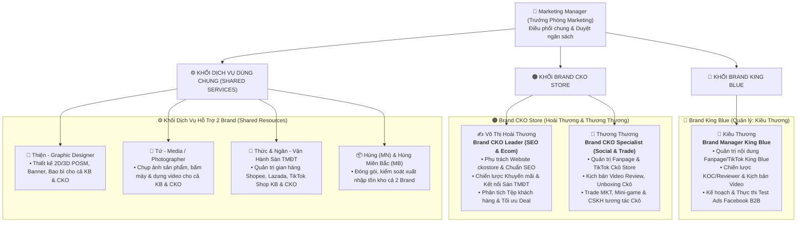

# 🏢 SƠ ĐỒ TỔ CHỨC & PHÂN BỔ BRAND MARKETING (KING BLUE & CKO STORE)

> 📌 **Mô hình Quản trị theo Thương hiệu (Brand Ownership)**:  
> - **Brand King Blue**: **Kiều Thương** quản lý toàn diện.  
> - **Brand CKO (Ckô Store)**: **Hoài Thương** và **Thương Thương** (đính chính tên chuẩn: Thương Thương) cùng phụ trách.  
> - **Khối Dịch vụ Dùng chung (Shared Services)**: Design (Thiện), Media (Tứ), Sàn TMĐT (Thức, Ngân), Kho vận (Hùng MN, Hùng MB) hỗ trợ cả 2 Brand.  
> - **Ban Quản Lý (Marketing Manager)**: Điều phối ngân sách, phê duyệt kế hoạch và chỉ đạo chiến lược.

---

## 1. Sơ Đồ Cấu Trúc Nhân Sự Theo Brand (Visual Org Chart)

---

## 2. Ma Trận Phân Công Trách Nhiệm Chi Tiết (Brand RACI Matrix)

| Nhóm / Brand | Nhân sự phụ trách | Vai trò & Trách nhiệm trọng tâm | Sản phẩm đầu ra (Deliverables) |
| :--- | :--- | :--- | :--- |
| **🔵 Brand King Blue** | **Kiều Thương** *(Brand Manager)* | - Quản trị toàn diện hình ảnh và sự phát triển của thương hiệu cốt lõi **King Blue**. - Kịch bản video test máy pin, unboxing, mẹo thợ trên TikTok/YouTube King Blue. - Chủ trì chiến dịch Booking KOC/KOL/Reviewer đồ nghề kim khí chuyên nghiệp. - Lên kế hoạch và thực thi chiến dịch chạy Ads Facebook B2B tìm kiếm đại lý mở điểm bán. | - 100% nội dung & kịch bản kênh King Blue. - Hợp đồng & video nghiệm thu KOC. - Báo cáo CPL, số lượng đại lý phát sinh từ Ads B2B. |
| **🟠 Brand CKO Store** | **Võ Thị Hoài Thương** *(Lead SEO & Ecom)* | - Quản trị và phát triển nội dung số cho thương hiệu bán lẻ **Ckô Store**. - Viết bài chuẩn SEO, cẩm nang người tiêu dùng trên hệ thống website Ckô. - Phối hợp với team Sàn TMĐT lên chiến lược giá, combo quà tặng và deal Flash Sale. - Rà soát danh mục khách hàng tiềm năng và đề xuất ngân sách marketing sàn. | - Bài viết chuẩn SEO website Ckô. - Bảng kế hoạch deal & chương trình khuyến mãi tháng. - Đề xuất chi phí ads sàn TMĐT tối ưu ROI. |
| **🟠 Brand CKO Store** | **Thương Thương** *(Social & Trade MKT)* | - Quản trị trực tiếp Fanpage và TikTok **Ckô Store** (đăng bài, minigame, tương tác). - Lên ý tưởng và viết kịch bản video review các dòng máy, thiết bị tiêu dùng Ckô. - Trực tiếp giải đáp thắc mắc, tư vấn khách hàng trên các kênh mạng xã hội Ckô. - Order hình ảnh, banner sản phẩm từ Designer để phục vụ đăng bài. | - Lịch bài đăng đều đặn hàng ngày trên MXH Ckô. - Kịch bản chi tiết 2-3 video review/tuần. - Tỷ lệ phản hồi tin nhắn khách hàng đạt > 95%. |
| **⚙️ Shared Service: Design** | **Thiện** *(Graphic Designer)* | - Tiếp nhận Order thiết kế từ Kiều Thương (King Blue) và Hoài Thương/Thương Thương (CKO). - Thiết kế banner sàn TMĐT, hình ảnh bài viết MXH, poster triển lãm Vietbuild, bao bì, nhãn vỉ. | - File in ấn chuẩn kỹ thuật (AI/Photoshop). - Bộ banner sản phẩm đúng kích thước & nhận diện từng Brand. |
| **⚙️ Shared Service: Media** | **Tứ** *(Photographer/Video)* | - Tiếp nhận Order quay chụp sản phẩm mới cho cả King Blue và Ckô Store. - Chụp ảnh sản phẩm nét cao (tách nền, bối cảnh xưởng), quay video test máy thực tế. - Dựng hậu kỳ video ngắn (Reels/TikTok) và video dài YouTube theo kịch bản của các Brand Manager. | - Kho ảnh raw & ảnh đã retouch trên Google Drive. - Video thành phẩm Full HD/4K đúng deadline task. |
| **⚙️ Shared Service: Ecom** | **Thức & Ngân** *(Vận hành Sàn)* | - Quản trị gian hàng chính hãng King Blue & Ckô Store trên Shopee Mall, Lazada, TikTok Shop. - Cài đặt chương trình Mega Sale theo chỉ đạo của Brand Manager, in đơn, nhập liệu, CSKH sàn. | - Doanh thu sàn TMĐT đạt chỉ tiêu. - Đơn hàng xử lý trong ngày, tỷ lệ phản hồi chat > 95%. |
| **⚙️ Shared Service: Kho vận** | **Hùng (MN) & Hùng MB** *(Fulfillment)* | - Tiếp nhận đơn hàng xuất bán của cả King Blue và Ckô Store. - Đóng gói chống va đập đúng quy cách, bàn giao đơn vị vận chuyển đúng giờ, báo cáo xuất nhập tồn. | - Đơn hàng giao vận đúng hạn, không bể vỡ. - Báo cáo sản lượng đóng gói & kiểm kê tồn kho. |

---

## 3. Cơ Chế Phối Hợp & Quy Trình Đặt Hàng Nội Bộ (Internal SLA)

1. **Quy trình Order Design & Media**:
   - Khi Brand King Blue (Kiều Thương) hoặc Brand CKO (Hoài Thương / Thương Thương) cần làm banner hoặc video sản phẩm mới:
     - Tạo task trực tiếp trên hệ thống [Quản Lý Công Việc](file:///Users/Admin/Documents/KIng%20BLue/quan_ly_cong_viec.html).
     - Gắn người thực hiện (**Thiện** cho Design, **Tứ** cho Media) kèm brief kịch bản/yêu cầu cụ thể và deadline rõ ràng.
2. **Quy trình Phân Bổ Ngân Sách**:
   - Mỗi Brand được phân bổ ngân sách marketing độc lập hàng tháng (chi phí Ads, chi phí KOC, quà tặng minigame).
   - Brand Manager chịu trách nhiệm về ROI (Hiệu quả chuyển đổi trên chi phí) của thương hiệu mình quản lý.
3. **Quy Tắc Tên Gọi & Tài Khoản Nội Bộ**:
   - Nhân sự phụ trách Brand CKO là **Thương Thương** (Mã PIN: `1003`), thống nhất trên mọi văn bản, báo cáo và hệ thống CRM (không sử dụng tên cũ Thụy Thương).
